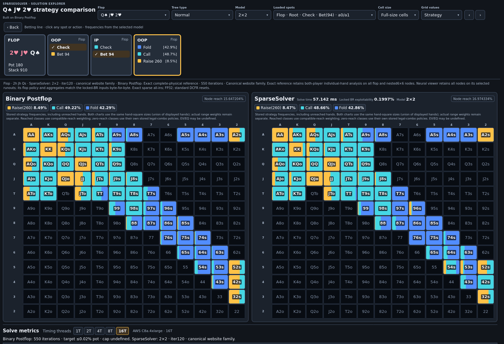

# SparseSolver

## 57 ms for a 3-bet flop solution at 0.2% locked best-response loss

**Q♠ J♥ 2♥ · 2×2 sampled-card model · 120 iterations · 16 CPU workers · 157.6 MiB peak RAM.**

Measured on AWS C8a.4xlarge: median native solve-loop time, excluding setup and
exports. The error is mean OOP/IP **flop-locked best-response loss**, distinct
from complete-policy exploitability. [Measurements](docs/benchmark.json).

[](https://deepborys.com/SparseSolver/)

*After check → bet: compare the fold / call / raise response in the 13×13 matrices.*

## What SparseSolver offers

- **Fast flop solving:** 0.1–0.3% locked-flop loss in 20–100 ms on tested cases.
- **Faster classical convergence:** suitable warm starts reduce early full-tree exploitability for hundreds of further iterations in our tests.
- **Interactive exploration:** the separate SparseViewer workflow supports selected subsecond turn-subtree refinements, with quality assessed in the complete game.
- **Flexible betting abstractions:** downstream bet sizes and strategy locks can affect flop strategy.
- **Lightweight CPU execution:** tested sparse solves need no GPU and use under 2 GiB RAM; classical full-tree verification requires more memory.
- **Open source and free for personal use:** [AGPL-3.0-or-later](LICENSE).
- **Whole-game validation:** refine the continuations, assemble a complete policy, then measure full-tree exploitability.
- **Classical handoff without a quality ceiling:** tested warm starts continued below 0.001% full-tree exploitability through classical solving.

**Flop-specific models:** each flop has its own trained NN models for 1×1,
2×2, 4×4 and 6×6. This release supplies **eight flops only**: `QsJh2h`, `As9h4d`,
`Ks4h4d`, `Js9s4h`, `QsTs7h`, `Js7h3d`, `Td9d6h`, and `Js8s3s`. They are not a
universal model for arbitrary flops. Sparse mode asserts immediately if the
requested flop/family or a required model file is missing. Classical `49x48`
requires no NN models.

## Study one node at a time

A user views one 13×13 matrix at a time. Sparse solving makes the flop strategy
available quickly; a requested turn continuation is refined together with its
rivers. The sparse times below measure **seed + one continuation**, while the
quality columns evaluate the complete policy assembled for offline validation.

**Q♠J♥2♥ · two sizes per street:** flop 25/75%, turn 33/100%, river 50/150%.

| Method | Iterations | Compute time | Full-tree exploitability | Flop locked | Flop + turn locked |
|---|---|---:|---:|---:|---:|
| Sparse 1×1 → 2×2 + unsafe100 | 50 + 25; +100 per frontier | **≈0.109 s** | **1.56831%** | 0.23962% | 0.51339% |
| Classical ≤1% | 89 | 29.755 s | 0.98961% | 0.10452% | 0.27721% |
| Sparse 2×2 → 6×6 + unsafe300 | 100 + 100; +300 per frontier | 1.162 s | 0.73304% | 0.08021% | 0.17751% |
| Classical ≤0.5% | 160 | 53.566 s | 0.49310% | 0.05274% | 0.16601% |

The ≈109 ms adds a **44 ms seed median + 65 ms mean continuation refinement**;
it is a sum of separate measurements and excludes the extra transfer into the
full tree. Assembling all 539 continuations for the quality check took 35.227 s
of refinement compute. The 1.162 s row is a clean seed-plus-one-refinement median,
with transfer excluded; classical times cover full-tree CFR with checks
interleaved. These measurements use 16 workers on Ryzen 7 9700X. Errors average
both seats, as percentages of starting pot, within the configured betting tree.
Finite reference/response tolerances limit comparisons of small differences.
[Table data](docs/street-lock-comparison.json).

Explore the [website](https://deepborys.com/SparseSolver/) and
[technical appendix](https://deepborys.com/SparseSolver/technical-appendix.html)
for the approach, browser solutions and full evaluation methodology.

## Run it yourself

On Ubuntu 24.04 x86-64, allow 30–40 GiB disk space for dependencies, builds,
models and caches. Every command detects the available CPU count automatically;
use `--threads N` to choose fewer workers. Four-worker timings and sixteen-worker
timings are separate measurements.

```bash
git clone --depth 1 --single-branch --branch main https://github.com/DeepBorys/SparseSolver.git
cd SparseSolver
bash setup.sh
bash run_quick_benchmark.sh
```

Start with the real [QJ2 flop example](examples/qj2_3bet_sparse.rs): its ranges,
`CardConfig`, `TreeConfig`, memory allocation and `solve_step` loop are all visible
in `main`, in Wataru’s style. Copy it and change the `flop_from_str("QsJh2h")` line
to study another supported flop. No TSV file supplies this example’s game inputs.

The [classical QJ2 example](examples/qj2_3bet_classical.rs) is identical except for
one default model setting:

```rust
let model = nn_model::Model::prepare("2x2", &card_config);   // sparse
let model = nn_model::Model::prepare("49x48", &card_config); // classical
```

[Wataru’s original `basic.rs`](examples/basic.rs) keeps its T96/Q **turn** starting point unchanged. The shared helper handles NN
setup/finalization and logging; game construction and iteration remain in the
QJ2 example files. TSV files are only used by the 40-situation batch driver.

The four editable QJ2 examples are [classical](examples/qj2_3bet_classical.rs),
[sparse](examples/qj2_3bet_sparse.rs), [warm start](examples/qj2_3bet_warm_start.rs)
and [selected-frontier refinement](examples/qj2_3bet_refine.rs).
The latter two use a stage list and optional histories expressed with Wataru’s
`Action` enum. See the [example guide](examples/README.md).

For the landing table's two-size schedules, see the three
[fast-strategy demonstrations](examples/README.md#two-size-fast-strategy-demonstrations).
They print flop/turn strategy matrices and timings without locked-loss checks.

Then try these workflows:

```bash
bash run_staged_example.sh --full-iterations 100
bash run_complete_policy.sh
bash download_models.sh
bash run_all_40.sh
```

The quick test prints timings, peak RAM, flop-log paths and `STATIC_CHECK_PASS`.
The full sweep covers **8 flops × 5 situations × 4 models = 160 configurations**.
Its optional [models-v1 archive](https://github.com/DeepBorys/SparseSolver/releases/tag/models-v1)
is approximately 1 GiB; private downloads require authentication or a local file.
The bundled QJ2 examples work without that optional download.

The assembly demo uses **single-size QJ2, 2×2/120 + local100**, with an expected
**1.30019%** full-tree exploitability. It demonstrates the pipeline using a
different configuration from the published two-size table above.

See the [command-line guide](docs/RUNNING.md) for authentication, all commands,
outputs, numerical checks and resume instructions. Training programs, dataset
generators and the private video/viewer implementation are excluded.

## Acknowledgments

Thank you to [Wataru Inariba (b-inary)](https://github.com/b-inary) for the original
[postflop solver](https://github.com/b-inary/postflop-solver) and
[WASM Postflop](https://github.com/b-inary/wasm-postflop). His work provides the
foundation for SparseSolver.

Thank you to the University of Alberta team and their collaborators for their
poker research, including [DeepStack](https://arxiv.org/abs/1701.01724), and to
[Lawson He](https://github.com/happypepper/DeepHoldem) for sharing DeepHoldem,
his Lua implementation, with testing and instructions.

## Copyright and license

Original solver: Copyright © 2022 Wataru Inariba.

SparseSolver modifications and additions: Copyright © 2026 Jerzy Slaby (DeepBorys).

Both are licensed under the **GNU Affero General Public License, version 3 or
later (AGPL-3.0-or-later)**. This software is provided without any warranty,
including the implied warranties of merchantability or fitness for a particular
purpose. See the [full license](LICENSE) and [attribution notice](NOTICE).

Wataru’s upstream history is preserved. SparseSolver was added from a reviewed
snapshot without the private development history.
